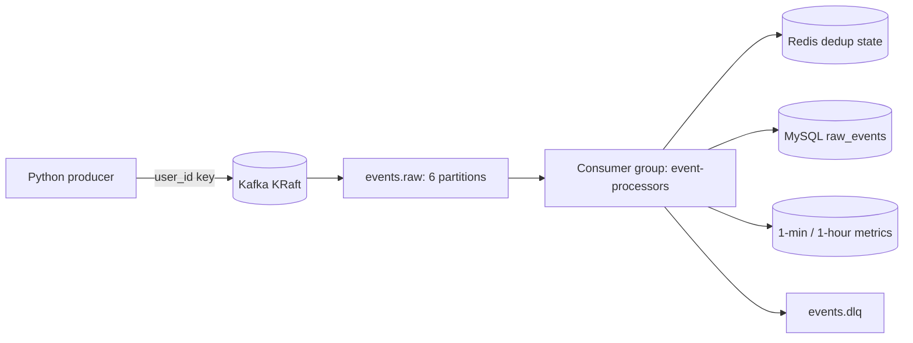

# Local-first real-time event pipeline

Python producers publish simulated e-commerce events to partitioned Kafka. A
Python consumer validates and processes them into Redis and MySQL, with a DLQ
for malformed, invalid, or permanently failed messages.



## Quick start

Prerequisite: Docker Desktop with the Linux engine running.

```powershell
Copy-Item .env.example .env
docker compose up -d kafka mysql redis kafka-init consumer
docker compose --profile demo run --rm producer
docker compose exec mysql mysql -uevents -pevents_password events -e "SELECT COUNT(*) FROM raw_events"
```

The equivalent workflow is `make up`, `make demo`, `make logs`, `make lag`, and
`make reset`. Scale consumers with `docker compose up -d --scale consumer=3`.

Run tests locally:

```powershell
python -m pip install -r consumer/requirements.txt pytest fakeredis ruff black
pytest -q
```

## Design decisions

* Kafka runs in KRaft mode with no Zookeeper. `kafka-init` creates the raw and
  DLQ topics idempotently.
* The producer key is `user_id`, so all events for a user go to one partition
  and retain per-user ordering. Kafka is still partitioned for horizontal
  consumer scaling.
* Delivery is at-least-once. Redis atomically marks an event `processing`,
  upgrades it to `done` only after the MySQL transaction commits, and deletes
  the marker on failure. MySQL's primary key plus `INSERT IGNORE` is defense in
  depth if Redis loses data. Together this gives effectively-once business
  writes without claiming Kafka exactly-once semantics.
* Aggregation uses `event_time`, not processing time. Late events update their
  original tumbling minute/hour window. `unique_users` is an incremental
  estimate, not an exact distinct count.
* Invalid JSON and schema-invalid JSON go to the DLQ immediately. Transient
  database/Redis failures retry three times with exponential backoff, then use
  `PROCESSING_FAILURE`.
* Offset commits happen only after batch processing and DLQ publication flush.
  Rebalances are logged through assign/revoke callbacks.

## Demo verification

Defaults inject 2% malformed JSON, 2% schema-invalid events, 5% duplicates, and
2% out-of-order timestamps. Override them in `.env`:

```powershell
docker compose --profile demo run --rm -e EVENT_COUNT=500 producer
docker compose exec mysql mysql -uevents -pevents_password events -e "SELECT event_type, COUNT(*) FROM raw_events GROUP BY event_type"
docker compose exec mysql mysql -uevents -pevents_password events -e "SELECT error_reason, COUNT(*) FROM dlq_events GROUP BY error_reason"
docker compose exec kafka kafka-consumer-groups --bootstrap-server kafka:29092 --describe --group event-processors
```

See [sql/analytics_queries.sql](sql/analytics_queries.sql) for five analytics
queries covering rate, revenue, products, DLQ reasons, and duplicate rate.

## Repository layout

* `producer/`: event model, fault injection, idempotent Kafka producer.
* `consumer/`: settings, validation, processing, Redis state machine, database
  transaction, aggregation, and DLQ envelope code.
* `sql/`: initialization schema and analytics queries.
* `tests/`: validation, deduplication, windows, and DLQ unit tests.

## What I would do next

Add Schema Registry with Avro or Protobuf compatibility checks; use Kafka
transactions for exactly-once boundaries where justified; offload ingestion
through Kafka Connect; and expose lag, processing rate, DLQ counts, and
Redis/DB errors through Prometheus and Grafana.
